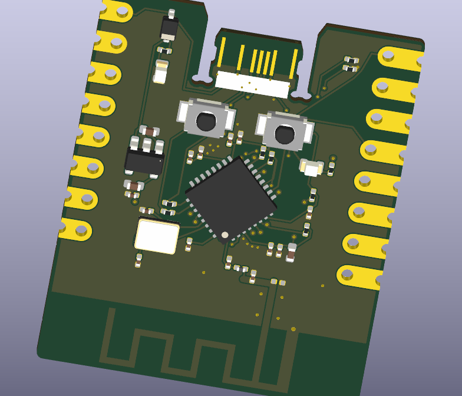
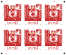

# ESP32-C3

MIFA-F4 is a development board based on the **Espressif ESP32-C3FH4**, with 4 MB of flash, 2.4 GHz Wi-Fi, and Bluetooth LE. A meandered inverted-F antenna (MIFA) is etched into the PCB. Contacts on both sides of the board edge form the USB-C interface.

## Hardware

| Feature | Specification |
| --- | --- |
| Board size | 24.54 × 29.90 mm |
| PCB | 0.8 mm, two-layer FR-4 with an ENIG finish and castellated edge holes |
| Antenna | Meandered PCB antenna based on TI AN043 |
| Headers | Two rows of eight pins on a 2.54 mm pitch, spaced 20.32 mm apart center to center |
| Buttons | BOOT pulls GPIO9 low. RESET pulls EN low. |
| Assembly | 35 components per board |
| Panel | Six boards in a 3 × 2 layout, 95.62 × 80 mm, 210 component placements |

## Board previews

**MIFA-F4 in the KiCad 3D Viewer**

**Six-board assembly panel**

## Interactive 3D View

[View the board in 3D](https://USERNAME.github.io/REPOSITORY/F4-live.html)

## Opening the design in KiCad

Download or clone the full repository to include the project libraries and 3D models. Open the [MIFA-F4 project](esp32c3mini-MIFA-F4/esp32c3mini.kicad_pro) in **KiCad 10**. Select the `.kicad_sch` file to view the schematic or the `.kicad_pcb` file to inspect the board layout. In the PCB Editor, press **Alt+3** to open the 3D Viewer.

## Fabrication and assembly

Choose the files for either a single board or a six-board panel. Use all three files from the same row.

| Format | PCB fabrication | Assembly parts list | Component positions and rotations |
| --- | --- | --- | --- |
| Single board | [Gerber ZIP](esp32c3mini-MIFA-F4/esp32c3mini-Gerber.zip) | [BOM](esp32c3mini-MIFA-F4/esp32c3mini-BOM.csv) | [CPL](esp32c3mini-MIFA-F4/esp32c3mini-CPL.csv) |
| Six-board panel | [Panel Gerber ZIP](esp32c3mini-MIFA-F4/panel/esp32c3mini-panel-Gerber.zip) | [Panel BOM](esp32c3mini-MIFA-F4/panel/esp32c3mini-panel-BOM.csv) | [Panel CPL](esp32c3mini-MIFA-F4/panel/esp32c3mini-panel-CPL.csv) |

For JLCPCB, upload the Gerber ZIP when ordering the PCB, then upload the matching BOM and CPL during assembly setup. Five assembled panels yield 30 individual boards.

## Prototype status

The design passed KiCad connectivity and schematic parity checks. Before assembly, verify the regulator orientation in the manufacturer's placement preview. With the component side facing up and USB-C at the top, the regulator should have three leads toward USB-C and pin 1 at the upper right.

Hardware validation is pending for USB-C operation in both plug orientations, supply stability during Wi-Fi transmission, and antenna performance on a board separated from the panel. See the [F4 validation notes](esp32c3mini-MIFA-F4/00-HOLD.txt).

## Prototype status and known limitations

**This board has not been physically tested.** The MIFA-F4 layout passed KiCad connectivity and schematic parity checks. Boot reliability, USB-C operation, power stability, and RF performance still require measurements on assembled hardware. Build and test a small prototype batch before ordering a production run.

### Before assembly

- Confirm the **0.8 mm PCB thickness** with the manufacturer. The board edge forms the USB-C mating surface, so thickness and routing tolerances affect the fit.
- Check the regulator orientation in the assembly preview. With the component side facing up and USB-C at the top, **U2 should have three leads toward USB-C and pin 1 at the upper right**. On the panel, the corresponding references are U102 through U602.

### First-prototype checks

| Area | What to verify |
| --- | --- |
| Power and boot | Check for a short between 3.3 V and GND before applying power. Use a current-limited supply for the first power-up, measure the 3.3 V rail, and check for voltage dips or resets during Wi-Fi transmission. Repeat cold starts to check boot reliability. |
| USB-C | Test plug fit, power delivery, USB detection, and firmware flashing in both plug orientations. Check that the connection stays stable during normal cable movement. Contact durability over repeated insertions is unverified. |
| BOOT and RESET | Confirm that holding BOOT while pressing and releasing RESET enters download mode, and that pressing RESET alone restarts the application. |
| Wi-Fi and antenna | Test a board **after separating it from the panel**. Compare signal strength and packet loss against a known-good ESP32-C3 board at the same distance and orientation on low, middle, and high Wi-Fi channels. Measure antenna return loss (S11) with a calibrated vector network analyzer to check impedance matching. |
| Board headers | Verify the 5 V, 3.3 V, and ground pins before connecting peripherals. Check the exposed GPIOs against the schematic and confirm the mechanical fit in the intended breadboard or carrier. |

The antenna layout follows TI AN043. Its range and susceptibility to interference from the nearby 40 MHz crystal are unverified on this PCB. See the [F4 validation notes](esp32c3mini-MIFA-F4/00-HOLD.txt) for layout dimensions and additional test details.
