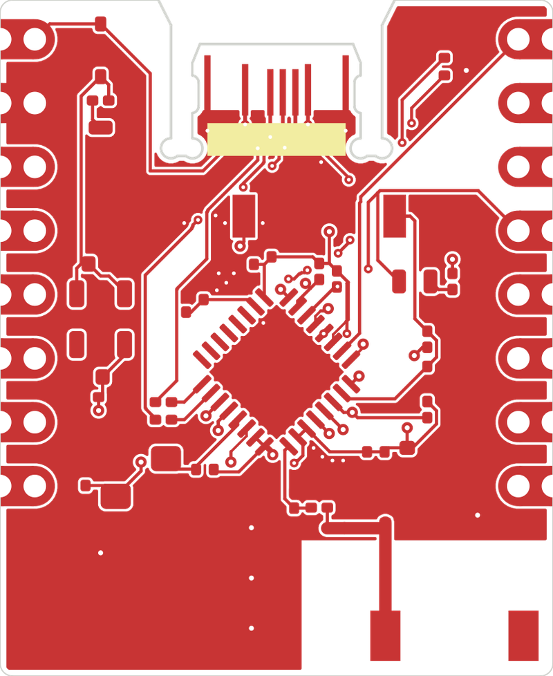

# esp32c3mini

Two revisions of an ESP32-C3FH4 development board with 4 MB of flash, Wi-Fi and Bluetooth LE. Contacts on both sides of the PCB form the USB-C interface. BOOT pulls GPIO9 low, and RESET pulls EN low.

| Revision | Antenna | Board size | Panel size (3 × 2 boards) | Components per board |
| --- | --- | --- | --- | ---: |
| [MIFA-F4](esp32c3mini-MIFA-F4/) | Meandered PCB antenna | 24.54 × 29.90 mm | 95.62 × 80 mm | 35 |
| [revD](esp32c3mini-revD/) | CA-C03 ceramic chip antenna | 22 × 26.90 mm | 88 × 74 mm | 37 |

## Board previews

**F4 in the KiCad 3D Viewer**

**revD top layout**

**F4 assembly panel**

## Opening the designs in KiCad

Download or clone the full repository so KiCad can find the project libraries. Open the [F4 project](esp32c3mini-MIFA-F4/esp32c3mini.kicad_pro) or the [revD project](esp32c3mini-revD/esp32c3mini.kicad_pro) in **KiCad 10**. Open the `.kicad_sch` file to inspect the schematic or the `.kicad_pcb` file to inspect the layout. Press **Alt+3** in the PCB Editor for the 3D view.

F4 has two rows of eight header holes on a 2.54 mm pitch. The rows are 20.32 mm apart, measured center to center. Use the layout for your chosen revision when designing a carrier board.

## Fabrication and assembly

Both revisions use a **0.8 mm, two-layer FR-4 PCB** with an **ENIG finish** and castellated holes along the edges. For a single board, use the files beside its KiCad project. For six boards per panel, use the [F4 panel files](esp32c3mini-MIFA-F4/panel/) (210 placements) or the [revD panel files](esp32c3mini-revD/panel/) (222 placements).

Upload the `-Gerber.zip` file for PCB fabrication. For assembly, upload the matching `-BOM.csv` (parts list) and `-CPL.csv` (component positions and rotations) from the same directory. Five assembled panels yield 30 individual boards.

## Prototype status

F4 passed KiCad connectivity and schematic parity checks. Before assembly, verify the regulator orientation in the manufacturer's placement preview. Prototype testing still needs to confirm USB-C operation in both plug orientations, supply stability during Wi-Fi transmission, and antenna performance. The revD hardware audit lists that revision as **on hold**.

[F4 validation notes](esp32c3mini-MIFA-F4/00-HOLD.txt) · [revD validation notes](esp32c3mini-revD/00-HOLD-REV-D.txt) · [revD assembly notes](esp32c3mini-revD/ASSEMBLY-NOTES.txt)
